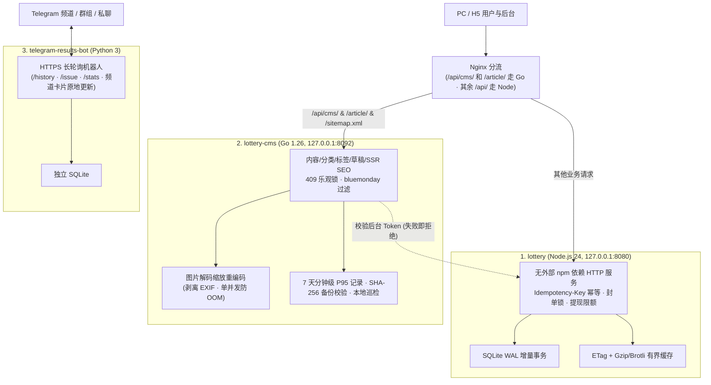

# 开奖数据站 + 独立 Go CMS + Telegram 机器人

> 更新日期：2026-11-23 · [返回主页](https://github.com/leee991)

同一台机器上配合跑的 3 个轻量服务：原来只有一个 Node.js 开奖业务站，后来为了解决并发落盘卡顿做了 SQLite WAL 改造；要加新闻资讯后台但不想动老业务，就用 Go 在旁边起了一个独立 CMS；另外用 Python 标准库写了个 Telegram 机器人查历史记录。

这三个服务都尽量**少引第三方包**（Node 主站 0 个服务端 npm 依赖、Python 机器人 0 个第三方 pip 依赖、Go CMS 只引了 `bluemonday` 做 HTML 过滤），部署和维护很省心。

## 整体结构

## 重点做过哪些改造

### 1. Node 主站性能优化（`lottery`）
- **去掉整库 JSON 落盘**：以前每下一单都要把整份 `db.json` 写一遍磁盘，并发高一点就顶不住。迁到 Node 24 原生 SQLite WAL 模式后，下单只写增量记录和变动用户，订单、流水、余额放进同一个事务里。
- **防弱网重复下单**：加了持久化的 `Idempotency-Key`，同一个用户带相同 key 重试会直接返回原订单，参数变了直接报 `409`。
- **风控小细节**：开奖期号结束前 10 秒自动锁定不让改，已有订单的期号也不让改；单笔提现卡死 5 万上限，专门写了 49999.99 / 50000 / 50000.01 边界测试。

### 2. 独立 Go CMS（`lottery-cms`）
- **不碰主站账本**：Go 进程只听 `127.0.0.1:8092`，不连业务库、不存管理员密码；每次管理操作把 Bearer Token 发给 Node 主站验一下，超时或异常一律直接拒（fail-closed）。
- **防多人改覆盖 & 防崩溃损坏**：更新文章必带 `version`，撞车返回 `409`；写数据文件全走临时文件 + `fsync` + 原子 `rename`；备份支持 SHA-256 校验，恢复前先自动存一份安全快照。
- **富文本和图片安全**：用 `bluemonday` 严格白名单过滤 HTML（限制节点数和嵌套层数，禁 script/SVG/iframe）；上传的图片真解码缩放再重新编码，把 EXIF 和尾随脏数据清掉，同时限制单并发上传防止把内存撑爆。
- **自带监控和巡检**：每分钟记一次 P95 耗时、错误率、Go 堆内存和 Linux 宿主机资源，保留 7 天；内容坏链巡检只查本地静态目录和媒体索引，不发任何外网请求（避免 SSRF）。`go test -race ./...` 和 `go vet` 都能直接过。

### 3. Telegram 机器人（`telegram-results-bot`）
- 纯 Python 标准库跑 HTTPS 长轮询，不用开公网端口；支持 `/history`、`/issue`、`/stats`、`/status`，频道卡片直接原地编辑同一条消息，不会每期刷屏。
- 数据同步做了严格校验，遇到期号冲突直接拒掉整批，保留原来的干净记录。

## 目录说明

- `docs/ARCHITECTURE.md`：为什么要这么拆、原子写盘与防 OOM 细节
- `docs/API_CONTRACT.md`：Go CMS 25+ 个接口、主站核心接口与机器人命令清单
- `config/`：Nginx 分流配置、Systemd 模板和 `.env.example`
- `skeleton/`：Node 主站、Go CMS 结构体/函数签名和 Python 机器人骨架
- `DIRECTORY_TREE.txt`：代码目录树统计
